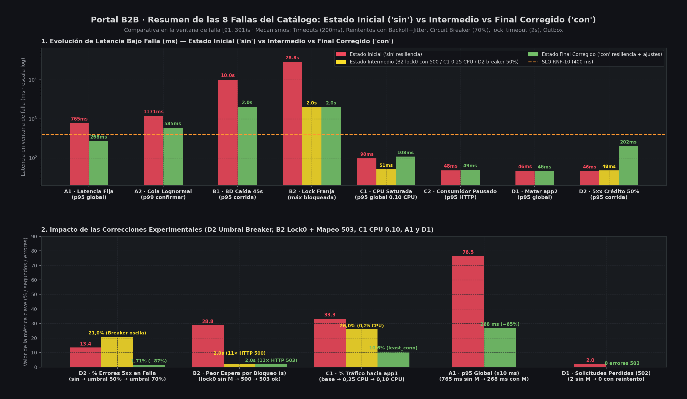
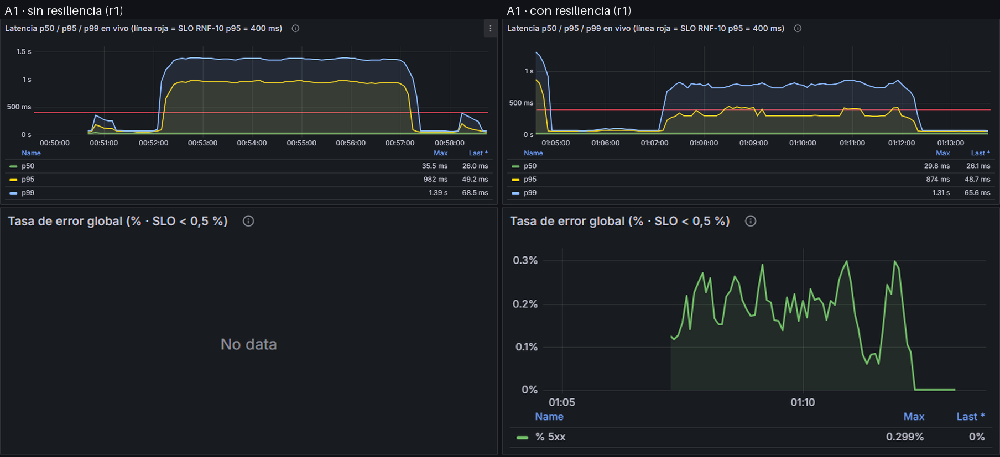
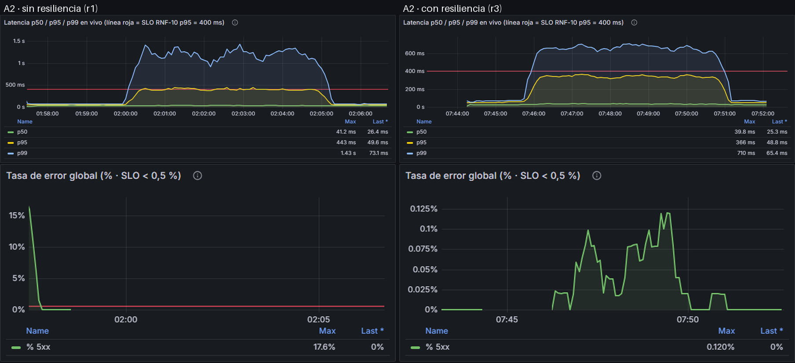
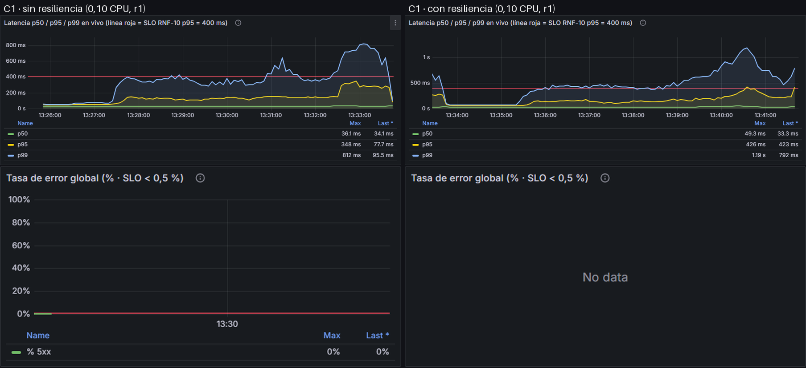
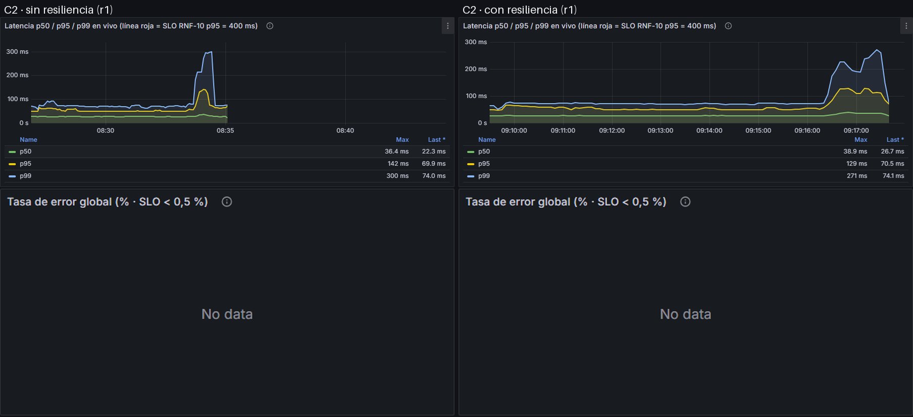
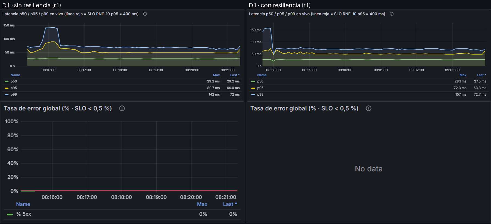
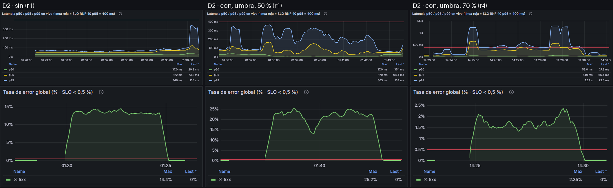
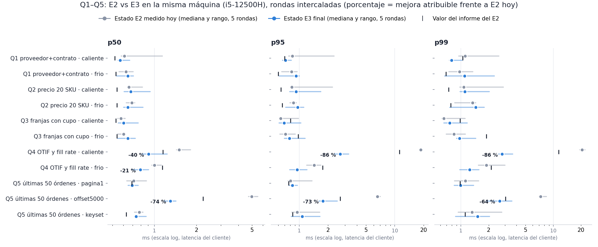

# Entregable 3 — Resiliencia y observabilidad del Portal B2B
**Aplicaciones y Sistemas Escalables · EAFIT · Equipo:** Esteban Jacob Romero Rios · Juan José Rodríguez Restrepo · Santiago Sabogal Lozano  
**Entrega:** viernes 16 de octubre de 2026 · **Versión final para la sustentación:** 9 de noviembre de 2026 (§3 combinación medida en vivo y §7 tabla E2–E3 rehechas; ver nota de integridad en §8) · **Commit de evidencia:** ver `manifest.txt` de cada corrida

## 1. Resumen y alcance
Se interrogó la plataforma (3 instancias del monolito modular detrás de nginx, PostgreSQL 16, stub de crédito, RabbitMQ con outbox transaccional) con **8 fallas del catálogo, 2 por familia** (A latencia, B base de datos, C degradación, D disponibilidad), cada una **sin** y **con** mecanismos de resiliencia, **≥ 2 repeticiones válidas** por configuración, carga de 200 solicitudes/s y semilla 42. Cada falla tiene una ficha con predicción escrita el 2026-10-14 22:55, **antes de medir**; las fichas no se editaron. Las diferencias entre lo predicho y lo medido están en `Entrega 3/experimentos/<ID>_resultado.md` y se resumen aquí.

**Resultado en una frase:** de las 8 predicciones, 1 se cumplió casi exacta (A1), 4 se cumplieron en el mecanismo pero erraron números relevantes (A2, B1, C2, D1) y 3 fallaron de fondo (B2, C1, D2) —en cada una el fallo reveló un supuesto falso y produjo una corrección que se volvió a medir. Se descubrieron **dos defectos reales** (un 500 donde debía haber un 503 controlado, y un breaker que empeora el error) y **un hallazgo abierto** (50 mensajes retenidos en el consumidor).

| Falla | Predicción | Veredicto | Lo más importante que se aprendió |
|---|---|---|---|
| A1 latencia fija en el externo | p95 global 770 ms sin / 300 con | **Cumplida** (765 / 268 ms) | Timeout 200 ms + 3 reintentos bajan el p95 global −65 % con 0,21 % de errores |
| A2 cola lognormal | p99 global 350 ms con M | **Parcial** (513 ms) | Los reintentos compran p99 (−50 %) pagando p95 (+14 %) |
| B1 PostgreSQL detenido | 18–25 % de errores; recuperación 10–35 s | **Parcial** (7–8 %; 4–9 s) | La carga real cae durante la falla: los flujos son secuenciales |
| B2 bloqueo de la franja 91150 | 12 bloqueadas, hasta 45 s | **Falló** (0) → corregida | Una predicción puede fallar por el *estado* del sistema; `lock_timeout` baja el peor caso de 29 s a 2 s |
| C1 CPU saturada en app1 | 12 % del tráfico, p95 400 ms | **Falló** (26 %, 51 ms) → corregida | `least_conn` sí reparte; la falla era demasiado débil |
| C2 consumidor pausado | lag lineal ≈ 15 600; sin impacto HTTP | **Parcial** | Independencia confirmada; drenado más lento; 50 mensajes sin confirmar |
| D1 matar 1 de 3 instancias | 2–8 × 502; reintegración ≤ 5 s | **Parcial** | 2 × 502; la reintegración tardó 5–15 s; sondeo de nginx de 2 s |
| D2 5xx del crédito (50 %) | breaker no empeora el error | **Falló** (21 % vs 13 %) → corregida | Umbral del breaker = probabilidad de la falla ⇒ oscila; con 70 % el error baja a 1,7–2,7 % |

## 2. Plataforma, método y línea base
**Plataforma.** Monolito modular (Órdenes, Proveedores, Catálogo, Logística; un esquema por módulo; fronteras verificadas en CI con import-linter), 3 réplicas stateless, nginx `least_conn` (`max_fails=3`, `fail_timeout=10s`, `proxy_connect_timeout=2s`), PostgreSQL 16 con 3,1 M de filas (Zipf, semilla 42), stub propio de crédito con fallas en caliente, RabbitMQ con transactional outbox y consumidor idempotente (`eventId`). Todo levanta con `make datos && make plataforma`.

**SLO (RNF-10):** p95 < 400 ms y errores < 0,5 % a 200 req/s. **Línea base oficial** (máquina del E2, `baseline/corridas/oficial-e3`, 300 s, semilla 42): p50 7,4 ms · p95 47,6 ms · p99 61,0 ms · 0 % de errores — **PASA**. Los percentiles de este informe son p50/p95/p99 sobre `solicitudes.csv`, ventana de falla [91, 391) s del generador (60–360 s de la ficha); nunca promedios.

**Método.** Línea base → ficha con predicción numérica → inyección → medición → mecanismo → corrección → re-experimento. Cada corrida reinicia el estado (`make reset-estado`), registra un `manifest.txt` (commit, imágenes, configuración de Docker) y guarda `solicitudes.csv`, `eventos.log`, `recursos.csv` y la verificación de negocio (`outbox_total` = CONFIRMADAS, `reservada ≤ total`). **Perfil M (con resiliencia):** timeout por intento 200 ms (techo 5 s), 3 reintentos con backoff exponencial y *full jitter* y presupuesto 1,5 s (siempre con la misma `Idempotency-Key`), circuit breaker (ventana 10 s, ≥ 20 intentos, semiabierto con 5 pruebas), bulkhead de 20, degradación con `Retry-After`, `lock_timeout` 2 s y timeout de pool 2 s.

**Validez de las corridas.** Criterio: la mediana previa a la falla (inicio_s 31–90) debe estar cerca de 7 ms. El portátil tuvo períodos de *throttling* (sin enchufar, al sol); **13 corridas con mediana previa ≥ 12–15 ms se descartaron y se repitieron** (`Entrega 3/evidencia/LEEME_descartadas.md`), en lugar de reportar cifras contaminadas. Cuatro corridas válidas (D1 `con` r4, D2 `umbral70` r3 y r4, B2 `con-lock0` r6) están en el límite (mediana previa 10–15 ms) y se reportan con esa reserva; para ellas se usa el % de errores, que es robusto, y no las latencias absolutas.

## 3. Motor de fallas (las cinco condiciones y combinación de las 8 fallas)

1. **Sin redespliegue:** `faults/faults.yaml` se recarga en caliente; el controlador de fallas aplica y revierte las de infraestructura. 2. **Parametrizada:** probabilidad, latencia, jitter, distribución, duración, CPU, retención. 3. **Focalizable:** por endpoint, porcentaje de tráfico, contenedor, franja o instancia. 4. **Reversible en segundos:** *kill switch* (`enabled: false`) que también libera el bloqueo de B2 y restablece CPU de C1; el script de experimentos lo ejecuta con `trap` ante cualquier salida. 5. **Reproducible:** misma configuración + semilla 42 ⇒ misma secuencia de flujos (verificado: en B2 las solicitudes bloqueadas aparecen en los mismos instantes —15,5 s, 25,0 s, 27,0 s…— en todas las corridas).

**Combinación de las 8 fallas e interacción entre mecanismos:** el motor en proceso (`stub/fallas.py`) y el controlador (`faults/controlador_fallas.py`) acumulan fallas sin desactivar las previas, y el kill switch revierte todas a la vez. **Combinación medida en vivo (`make demo-vivo`, misma carga de 200 req/s y semilla 42 en los dos estados; `resultados/demo_comparacion.md`): A1 + D2 + B2.** A1 y D2 atacan la misma dependencia y suman fallos en la ventana del breaker: con timeout de 200 ms por intento, un intento falla con probabilidad 1 − 0,7 × 0,5 = 65 %, justo debajo del umbral corregido (70 %); con el umbral original (50 %) el breaker quedaría abierto. B2 ataca la BD: la confirmación de la franja 91150 espera el lock dentro de la transacción. Predicción escrita antes de correr: ≈ 27 % de confirmaciones con error en el estado inicial (0,5 × 54 % que llega al crédito) y ≈ 9,6 % en el final (0,65⁴ = 17,9 % de llamadas que agotan 4 intentos × 54 %). Medido en la ventana durante la falla: error en confirmar **27,5 % → 9,4 %**, error global 13,7 % → 4,7 % (−66 %), p95 775 → 532 ms, p99 1 067 → 838 ms, peor confirmación 34,8 s → 3,2 s (lock cortado por `lock_timeout`: 10 × 503 `franja_bloqueada`), 0 respuestas `breaker_abierto`; la línea base previa es igual en ambos estados (p95 42 vs 46 ms). El estado final **no cumple el SLO** bajo esta combinación, con el residuo predicho; cumplirlo exigiría aprobar sin crédito (RN-11). Una corrida previa de la misma demo en un equipo saturado (mediana previa de segundos) dio 24 % de error con el breaker abierto antes de inyectar; se descartó con el criterio de validez de la §2.

## 4. Observabilidad
RED por endpoint y por instancia (`portal_http_*`, p50/p95/p99), USE por recurso (cAdvisor para CPU/memoria, pool de BD, colas de RabbitMQ), traza distribuida con `x-trace-id` y Jaeger, tablero único en Grafana (`uid portal-b2b`) con el p99 en tiempo real, y un muestreador propio por corrida (`recursos.csv`, `salud.csv`, `lag.csv`). **Límites honestos:** (a) varias métricas citadas en las fichas (`portal_bd_lock_timeouts_total`, `portal_degradaciones_total`) no existían; las cifras salen de `solicitudes.csv` y de contadores añadidos con las correcciones; (b) `rabbitmq_queue_messages_unacked` y las transiciones del breaker no se archivaron por corrida: se infieren de `lag.csv` y de las causas de error.

*(Figuras detalladas por experimento en `Entrega 3/evidencia/<ID>/capturas/<config>.png` — p99, p95, errores y recursos/lag durante la falla, con la ventana sombreada.)*
*(Figuras: capturas de Grafana por experimento; las originales están en `Entrega 3/evidencia/<ID>/capturas/`.)*

## 5. Resultados por experimento (predicho vs medido)
Cifras en la ventana de falla salvo indicación. "Sin" = valores por defecto; "con" = perfil M.

**A1 · Latencia fija (30 % de las llamadas al externo, +500–1 100 ms).** Predicción cumplida. p95 global: sin **765** ms (predicho 770) · con **268** (300). p99 global 1 066 / 552 (1 070 / 545). Errores: 0 % / **0,21 %** (0,22 %), todos 503 `TimeoutError` a 1,0 s; el breaker no abrió. Mecanismo: el 30 % de ≈ 27 % de las solicitudes es ≈ 8 % > 5 %, así que la cola lenta entra al p95. SLO: sin **NO**, con **SÍ**. *Evidencia:* `A1/{sin,con}_r{1,2}`.

**A2 · Cola larga lognormal (σ = 1,5).** Sin M casi exacto: p95 global 228 (260), p99 confirmar 1 171 (1 200), máximo 20 s. Con M el p99 de confirmar bajó **−50 % (1 180 → 585 ms)** y desaparecieron los rezagados de 20 s, pero **el p95 global subió 230 → 262 ms (+14 %)** y el p99 global (513) quedó por encima de lo predicho (350). Los reintentos intercambian p95 por p99: el 20 % de las llamadas con intento > 200 ms paga timeout + backoff. Errores 0,05 %. `con_r1` tuvo un episodio ajeno (522 errores) y se excluyó. *Evidencia:* `A2/{sin_r1,sin_r2,con_r2,con_r3}`.

**B1 · PostgreSQL detenido 45 s.** Latencia de los errores como se predijo: **10,0 s** sin M y **2,0 s** con M (`BD_POOL_TIMEOUT_S=2`); p95 de la corrida 10,0 / 2,0 s. Dos números fallaron: (1) errores en la corrida **6,6–7,0 %** (sin) y **8,1–8,5 %** (con), no 18–25 %, porque un flujo es secuencial y un `crear` fallido cancela su `confirmar`: la carga real fue ≈ 104 req/s, no 200; (2) la recuperación fue de **4–9 s** tras `docker start`, no 10–35 s: el backoff del pool no se materializó. Con M se gana latencia del error (−80 %) a costa de más errores totales: es un intercambio espera↔error, no una mejora neta. Negocio: `outbox_total` = CONFIRMADAS en las 4 corridas (0 eventos perdidos), 0 violaciones de capacidad. Hallazgo abierto: `con_r3` mostró 109 respuestas `breaker_abierto` y 112 órdenes EN_PROCESO (causa no investigada). *Evidencia:* `B1/{sin_r1,sin_r2,con_r1,con_r3}`.

**B2 · Bloqueo `FOR UPDATE` de la franja 91150.** Original: **0** solicitudes bloqueadas, no las ≈ 12 predichas: la franja se llena a los 15,5 s del generador y desde entonces `UPDATE … WHERE reservada < total` no tiene fila candidata, así que no espera el bloqueo (el caso borde del último cupo quedó protegido, pero la prueba no ejercitó el bloqueo). Variante `lock0` (bloqueo desde el arranque, 60 s): **sin M** 6 confirmaciones medidas (11 en total) esperaron hasta **28,8 s** (predicho 25–30); **con M** `lock_timeout` las cortó a **2,0 s** (−93 %), sin tocar p95/p99 globales. Esa re-ejecución destapó un defecto: las bloqueadas devolvían **HTTP 500** (`LockNotAvailable` sin mapear). Se corrigió en `servicio.py` (→ 503 `franja_bloqueada`, orden EN_PROCESO, clave liberada, `Retry-After`), con predicción fechada antes de re-ejecutar; las corridas r5/r6 confirmaron 11–12 × 503 y 0 × 500. Invariante `reservada ≤ total`: 0 violaciones en todas. *Evidencia:* `B2/{sin,con}_r{1,2}`, `B2/{sin,con}-lock0_r{3..6}`.

**C1 · CPU saturada en app1.** Original (0,25 CPU): reparto **26/37/37 %** (predicho 12/44/44), p95 global **51–59 ms** (380–480): cada solicitud cuesta ≈ 4–5 ms de CPU y 0,25 CPU atiende ≈ 55 req/s, casi su cuota. Re-ejecución a **0,10 CPU** (predicción previa): reparto **11/44/44 %** ✓, p95 de app1 **394 ms** (predicho ≈ 300, rango 150–600) ✓, p95 global **98 ms** (≈ 100) ✓, 0 % de errores, SLO sí. `least_conn` sí desvía por carga efectiva. **El perfil M no aportó nada**: el `limit_req` de 250 req/s no se activa a 200 req/s; con M la cola de app1 fue peor (p95 544–601 vs 394 ms; "sin 0,10" tiene una sola repetición válida). La recuperación tardó ≈ 60 s, no ≤ 5 s. *Evidencia:* `C1/{sin,con}_r*`, `C1/{sin,con}-cpu010_r*`.

**C2 · Consumidor pausado 300 s.** Independencia síncrono/asíncrono confirmada: p95/p99 HTTP **45–49 / 56–63 ms**, 0 % de errores. Cola de RabbitMQ creció linealmente hasta **15 285–15 405** (predicho ≈ 15 600), outbox ≤ 37, **0 eventos perdidos** (`outbox_total` = CONFIRMADAS = 23 269). Falló el drenado: **74 s** (predicho 15–30 s) con p50 HTTP de 11–16 ms durante el catch-up. **Hallazgo abierto:** en 3 de 4 corridas quedan **exactamente 50 mensajes** (el `prefetch`) sin confirmar; en `con_r3` los eventos procesados son 23 219 de 23 269. No se perdió nada (siguen en la cola) pero la causa no está diagnosticada. *Evidencia:* `C2/{sin_r1,sin_r2,con_r1,con_r3}`.

**D1 · Matar app2 60 s.** Reparto 50/0/50 % ✓, nginx dejó de enviarle tráfico desde el segundo siguiente a la muerte, **2 × 502** sin reintentos de cliente (predicho 2–8) y 0 con reintentos, errores 0,003 %, 0 duplicados, p95 **44–49 ms** (predicho 110–140: sobreestimado). No predicho: nginx sondea a la caída cada ≈ 13 s y cada sondeo cuesta ≈ **2,0 s** a 1–2 solicitudes (10–12 solicitudes > 1 s en 60 s); la reintegración tardó **4,6–14,9 s** (predicho ≤ 5). El reintento de cliente tiene un hueco: un 409 `confirmacion_en_curso` (clave dejada EN_CURSO por la instancia muerta) no es reintentable. *Evidencia:* `D1/{sin_r1,sin_r2,con_r1,con_r4}`.

**D2 · 5xx del crédito al 50 %.** Sin M exacto: **13,4 %** de errores (predicho 13,5). **Con M (umbral 50 %) falló: 21,0 %**, 12 700 de ellos por `breaker_abierto`: la falla devuelve 503 con probabilidad 50 %, igual al umbral, así que la tasa observada oscila alrededor y el breaker abre y cierra continuamente, rechazando incluso las llamadas que el stub habría atendido; el remedio **empeoró** el error de 13,4 a 21 %. Corrección (predicción previa): umbral **70 %**. Resultado: errores **1,7 % y 2,7 %** (predicho ≈ 1,7 %, 1–3 %), −80 a −87 % frente a "sin"; el residuo es 0,5⁴ = 6,25 % de las llamadas lógicas que agotan 4 intentos. En una de las dos corridas el breaker abrió igualmente (523 rechazos): subir el umbral reduce la oscilación pero no la elimina con un host lento. RN-11 intacta: ninguna orden se aprobó sin crédito. SLO de errores sigue **NO** (esperado y declarado). *Evidencia:* `D2/{sin,con}_r{1,2}`, `D2/con-umbral70_r{3,4}`.

## 6. Qué se corrigió y qué se volvió a medir

| Hallazgo | Causa raíz | Corrección | Re-medición |
|---|---|---|---|
| Breaker del 50 % empeoraba D2 | Umbral = probabilidad de la falla | `BREAKER_UMBRAL_FALLOS_PCT=70` | 21,0 % → 1,7–2,7 % de errores |
| B2 no ejercitaba el bloqueo | La franja se llena a los 15,5 s | Bloqueo desde el arranque (`lock0`) | 0 → 11 solicitudes bloqueadas; 28,8 s → 2,0 s con `lock_timeout` |
| B2 devolvía 500 con `lock_timeout` | `LockNotAvailable` sin mapear | Mapeo a 503 `franja_bloqueada` en `servicio.py` | 11 × 500 → 11 × 503; 0 × 500 |
| C1 no estresaba la plataforma | Costo por solicitud subestimado (4–5 ms) | 0,25 → 0,10 CPU | Reparto 26 → 11 %; p95 de app1 100 → 394 ms |

**Lo que más sorprendió:** (i) la resiliencia no es monotónica: el mismo mecanismo (breaker, reintentos) mejoró A1, trade-off en A2 y empeoró D2; (ii) tres de ocho predicciones fallaron por supuestos sobre el *estado* o la *carga* del experimento, no sobre el sistema; (iii) el perfil M no sirve para C1 ni para B1 (intercambia espera por error).

**Qué sabemos ahora que NO volveríamos a hacer (aprendizajes de ingeniería):**

1. **No fijar el umbral del Circuit Breaker igual a la tasa de falla intermitente que los reintentos pueden absorber:** Con umbral 50 % frente a una falla del 50 % (D2), la fluctuación estadística abre y cierra el circuito continuamente (*flapping*), rechazando llamadas que 1–3 reintentos habrían salvado y subiendo el error de 13,4 % a 21,0 %.
2. **No inyectar una falla de contención de inventario (B2) en $t = 60\text{ s}$ sin verificar primero cuándo se agota el recurso bajo carga:** La franja 91150 agotaba sus 10 cupos en $t = 15,5\text{ s}$ del calentamiento, haciendo que `UPDATE ... WHERE reservada < total` en $t = 60\text{ s}$ no tuviera filas candidatas ni esperara el lock.
3. **No dejar excepciones de timeout de infraestructura (`psycopg.errors.LockNotAvailable`) sin mapear en la capa de dominio:** Al activar `lock_timeout = 2000ms`, los cortes caían en el manejador genérico como HTTP 500 en vez de responder HTTP 503 degradado con `Retry-After` y liberar la clave idempotente.
4. **No asumir que los reintentos mejoran todos los percentiles ni dimensionar límites de CPU sin medir el costo unitario:** En A2 los reintentos bajan el p99 un −50 % pero encarecen el p95 un +14 %; en C1 cada solicitud costaba ~4–5 ms de CPU, por lo que `0,25 CPU` aún absorbía casi toda la cuota de la instancia.
5. **No sincronizar contenedores WSL2 con el reloj del host Windows (`Git Bash` deriva ~4 %) ni correr colas de benchmark con el equipo desenchufado:** El *throttling* energético obligó a descartar y repetir 13 corridas (`LEEME_descartadas.md`).

## 7. Meta de mejora −10 %: tiempos del Entregable 2 frente al Entregable 3
**Qué exige la rúbrica y cómo se midió.** Misma consulta (Q1–Q5 del E2), mismo escenario (frío/caliente, página 1, OFFSET 5000, keyset), misma métrica (p50/p95/p99 de latencia del cliente, nunca promedios ni throughput) y condiciones comparables. Para que la mejora sea **del sistema y no de la máquina**, `make comparar-e2` (`baseline/ab_e2_e3.sh`) mide los dos estados en la misma máquina, la misma sesión y los mismos datos (semilla 42), con el mismo cliente del E2 (`medicion/medir.py`: 20 de calentamiento + 200 ejecuciones, `force_custom_plan`), plataforma detenida como en el E2, y **5 rondas intercaladas E2 → E3 → E2 → E3…** para que la deriva térmica afecte por igual a ambos:

- **Estado E2:** consultas del commit `a1b9141` (entregado en el E2) + el índice `idx_ordenes_proveedor_fecha` del E2.
- **Estado E3:** consultas finales (`datos/consultas.sql`) + índices finales (`modelo-fisico.sql`).

Una métrica solo cuenta como **mejora atribuible** si la mediana E3 ≤ 0,9 × la mediana E2 medida hoy **y** ninguna de las 5 rondas E3 se solapa con las rondas E2. Antes de medir, el script verifica que la Q4 nueva devuelve **exactamente lo mismo** que la del E2 (`equivalencia_q4.txt`: idéntica en 286 comparaciones —143 proveedores calientes, fríos, borde y aleatorios × 2 ventanas—, 4 433 filas).

**Qué se cambió (dos palancas, `baseline/palancas.md` §4).**

- **L4 · Modelo de lectura de entregas para Q4.** El E2 calculaba OTIF y fill rate leyendo las líneas de cada orden: para el proveedor 1 son ~4 000 sondeos a `idx_lineas_orden` por consulta, y ese era el costo dominante (el índice cubriente P1 del E3 solo bajó el servidor de 1,93 a 1,46 ms y quedó dentro del ruido en el cliente). Ahora `ordenes_compra` guarda `unidades_pedidas`, `unidades_surtidas` y `entrega_completa`, mantenidas por **triggers de sentencia con tablas de transición** sobre `lineas_orden` (desnormalización controlada: la fuente de verdad sigue siendo `lineas_orden`). Q4 ya no toca las líneas y pasa a un **Index Only Scan con 0 Heap Fetches**.
- **L5 · Índice cubriente también para Q5.** El índice incluye `numero_orden` y `total_orden`: Q5 OFFSET 5000 deja el Bitmap Heap Scan + Sort de 5 293 filas y recorre el índice en orden.

**Tabla E2 vs E3 en la máquina del E2** (i5-12500H, la misma del informe del E2; corrida `baseline/corridas/ab-e2-e3-oficial`, 33 filas en `tabla_e2_e3.md`). ms de latencia del cliente; mediana de 5 rondas y rango.

| Consulta · escenario | Métrica | E2 informe | Meta (−10 %) | E2 hoy [rango] | E3 final [rango] | E3 vs E2 hoy | Cumple meta | Mejora atribuible |
|---|---|---:|---:|---:|---:|---:|:---:|:---:|
| Q4 OTIF · caliente | p50 | 1,15 | 1,04 | 1,51 [1,44–1,82] | **0,91** [0,82–1,24] | **−40 %** | **SÍ** | **SÍ** |
| Q4 OTIF · caliente | p95 | 11,17 | 10,05 | 18,68 [18,14–18,98] | **2,68** [2,33–3,30] | **−86 %** | **SÍ** | **SÍ** |
| Q4 OTIF · caliente | p99 | 11,48 | 10,33 | 20,57 [19,34–21,99] | **2,80** [2,56–3,65] | **−86 %** | **SÍ** | **SÍ** |
| Q4 OTIF · frío | p50 | 1,14 | 1,03 | 1,00 [0,96–1,12] | **0,79** [0,69–0,91] | **−21 %** | **SÍ** | **SÍ** |
| Q4 OTIF · frío | p95 / p99 | 1,75 / 2,13 | 1,58 / 1,92 | 1,43 / 1,89 | **0,95 / 1,25** | −34 / −34 % | SÍ | solo en mediana |
| Q5 · OFFSET 5000 | p50 | 2,23 | 2,01 | 4,98 [4,73–5,52] | **1,31** [1,17–1,43] | **−74 %** | **SÍ** | **SÍ** |
| Q5 · OFFSET 5000 | p95 | 2,67 | 2,40 | 6,57 [6,33–7,04] | **1,77** [1,61–2,49] | **−73 %** | **SÍ** | **SÍ** |
| Q5 · OFFSET 5000 | p99 | 3,04 | 2,74 | 7,29 [6,97–8,42] | **2,63** [1,88–3,57] | **−64 %** | **SÍ** | **SÍ** |
| Q5 · página 1 | p50 / p95 / p99 | 0,69 / 0,77 / 0,98 | 0,62 / 0,69 / 0,88 | 0,71 / 0,81 / 1,12 | 0,69 / 0,84 / 0,99 | −2 / +4 / −11 % | NO | no aplicable |
| Q1, Q2, Q3, Q5 keyset (frío y caliente, 21 filas) | p50 / p95 / p99 | 0,52–1,89 | — | 0,58–1,34 | 0,57–1,51 | −29 % a +15 % | 5 de 21 (Q1 cal. p99, Q3 p95/p99) | no aplicable |

**Plan de ejecución (servidor, `EXPLAIN ANALYZE`, `explain_e2.txt` / `explain_e3.txt`):** Q4 caliente **23,1 → 2,5 ms** (Bitmap Heap Scan + Nested Loop a líneas → Index Only Scan, 0 Heap Fetches); Q5 OFFSET 5000 **5,5 → 0,83 ms** (Bitmap + Sort → Index Only Scan ordenado).

**Réplica en otra máquina.** La misma prueba en la máquina de JJ (i5-12450HX, `baseline/corridas/ab-e2-e3-maquina-jj`, figura `e2_vs_e3_consultas_maquina_jj.png`) da las mismas mejoras atribuibles en Q4 caliente y Q5 OFFSET (p95: Q4 15,70 → 2,76 ms, −82 %; Q5 7,83 → 1,98 ms, −75 %; las seis entre −32 % y −83 %) y el mismo veredicto de "no aplicable" para Q1–Q3. La única diferencia es Q4 frío p50, que allí queda solo en mediana. Como E2 y E3 se miden juntos en cada máquina, la atribución no depende del equipo.

**Lectura honesta.**

1. **7 de 33 métricas mejoran de forma atribuible al sistema** (Q4 caliente p50/p95/p99, Q4 frío p50 y Q5 OFFSET 5000 p50/p95/p99), entre −21 % y −86 %, sin solape entre rondas. Son exactamente las dos consultas donde había trabajo de base de datos que quitar.
2. **14 de 33 cumplen la meta frente al valor del informe del E2, pero 7 de esas no se atribuyen a nada:** Q4 frío p95/p99 bajan −34 % solo en mediana (las rondas se solapan), y Q1 caliente p99 y Q3 p95/p99 (frío y caliente) "cumplen" porque ese día el mismo estado E2 ya midió por debajo del informe (por ejemplo, Q3 caliente p95: E2 hoy 0,64 ms frente a 0,81 ms del informe), mientras que E3 no mejora frente a E2 hoy (+8 % a +15 %, dentro del ruido).
3. **Q1, Q2, Q3 y Q5 página 1 / keyset no tienen palanca de base de datos:** el servidor las ejecuta en ≈ 0,05 ms y el cliente ve 0,6–1,5 ms; ese tiempo es la ida y vuelta Docker → PostgreSQL y la planificación con `force_custom_plan`. En la misma máquina del E2, el mismo estado E2 mide hoy 0,58–1,34 ms frente a 0,52–1,89 ms del informe: la variación entre días es mayor que cualquier mejora posible. Se declaran **no aplicables** con esa evidencia, como permite la rúbrica. No se usó caché.
4. **Costos de L4/L5:** +3,3 s en la carga masiva (relleno del modelo de lectura), un `UPDATE` adicional de la orden por cada sentencia que escribe líneas (la app inserta todas las líneas de una orden en una sola sentencia), índice de 12 → 30 MB, y `estado` dentro del índice impide actualizaciones HOT al confirmar. Las 14 pruebas de aceptación y las 8 pruebas de humo siguen en PASA con los triggers.

**Ruta transaccional (complemento, no es Q1–Q5).** P8 —validar el catálogo de una orden con una sola consulta (`unnest`) y cargar las líneas con `executemany`— bajó el E4 de 50 000 órdenes de **437,6 s** (línea base oficial del E3 antes de P8, `baseline/corridas/oficial-e3`) a **298,9 s** (`baseline/corridas/meta-P8`), con 29 235 órdenes aceptadas y 219 720 filas en ambas; en A/B intercalado sobre 10 000 órdenes (3 pares) la mediana pasó de 134,8 a 68,3 s (−49 %, ruido del control 18 %). Es una mejora del código de la ruta, no del motor, y el E4 completo con P8 se midió una sola vez.

**Lo que se retiró de versiones anteriores de esta sección** porque no es evidencia de optimización: COPY 15,63 → 13,27 s, carga total 24,91 → 21,64 s y E3 fila a fila 56,6 → 43,4 s se midieron **sin ningún cambio** en esas rutas (variación de la máquina: en esa misma corrida oficial el COPY sin índices salió un 21 % *más lento*, 0,709 → 0,857 s); por la regla de la §1 de `palancas.md` no se atribuyen a nada. P2 (`jit = off`) y P3 (`random_page_cost`) quedaron dentro del ruido y se descartaron.

## 8. Conclusiones, limitaciones y trabajo pendiente

1. **Con el perfil M la plataforma cumple el SLO en 6 de las 8 fallas** (A1, A2, B2, C1, C2, D1) y lo incumple por diseño en B1 (sin BD no hay confirmación posible) y D2 (50 % de 503 del externo deja ≈ 1,7 % de errores residuales, sobre el 0,5 % del presupuesto).
2. **Nunca se aprobó una orden sin crédito, nunca se perdió un evento y la invariante `reservada ≤ total` no se violó** en ninguna de las corridas válidas (`outbox_total` = CONFIRMADAS; 0 violaciones).
3. **Defectos abiertos:** (a) 50 mensajes sin confirmar tras reanudar el consumidor (C2); (b) 109 `breaker_abierto` y 112 EN_PROCESO en B1 `con_r3`; (c) el 409 no reintentable tras matar una instancia (D1); (d) el breaker con umbral 70 % puede abrirse igualmente con un host lento.
4. **Limitaciones de la medición:** el reloj del contenedor avanza ≈ 4 % más rápido que el de pared (la falla puede desfasarse unos segundos de la ficha); corridas descartadas por *throttling* del equipo (13); cuatro corridas válidas con reserva; "sin 0,10 CPU" con una sola repetición; el rate limit se implementó en nginx porque `RATE_LIMIT_*` no estaba conectado en la app; el breaker no se probó con 100 % de fallas del crédito; los episodios de la plataforma ajenos a la falla (A2 `con_r1`, B2 `con-lock0_r5`) se conservan como evidencia pero no entran en las cifras.
5. **Qué haríamos con más tiempo:** diagnosticar el lote retenido del consumidor; archivar las transiciones del breaker y los unacked por corrida; bajar `proxy_connect_timeout` en nginx; probar el breaker con una caída total del crédito; repetir cada experimento en una máquina sin *throttling*.
6. **Nota de integridad (versión final, 9 nov):** un commit de evidencia había sobrescrito `baseline/corridas/oficial-e3/{comparacion_e2,estrategias}.csv` con el resultado de P8 (E4 298,9 s); se restauró la línea base oficial (E4 437,6 s) y P8 queda en `baseline/corridas/meta-P8`. La §7 se rehízo: la versión anterior presentaba como mejora tiempos que cambiaron sin ningún cambio en el sistema (COPY, carga total, E3 fila a fila) y no tenía la tabla Q1–Q5 por percentil.
7. **Entrega final en una frase:** bajo la combinación A1 + D2 + B2 en vivo el estado final reduce dos tercios el error y el peor caso de ≈ 35 s a ≈ 3 s, con el residuo predicho antes de medir y sin cumplir el SLO (§3); y las dos consultas con trabajo de base de datos que quitar (Q4 y Q5 OFFSET) mejoran entre −21 % y −86 % en 7 de 33 métricas frente al mismo estado del E2 medido junto a ellas en la máquina del E2, con réplica en una segunda máquina, mientras Q1–Q3 se declaran no aplicables con evidencia (§7).

*Reproducir:* `make demo-vivo` (combinación en vivo, ~5 min) y `make comparar-e2` (tabla E2–E3, ~10 min); además `make datos && make plataforma && make baseline`; un experimento: `bash faults/experimento.sh <ID> <sin|con|con-VARIANTE> <rep>`; todo el catálogo: `make cola`. Evidencia: `Entrega 3/evidencia/<ID>/<config>_r<n>/` y `Entrega 3/experimentos/`.
